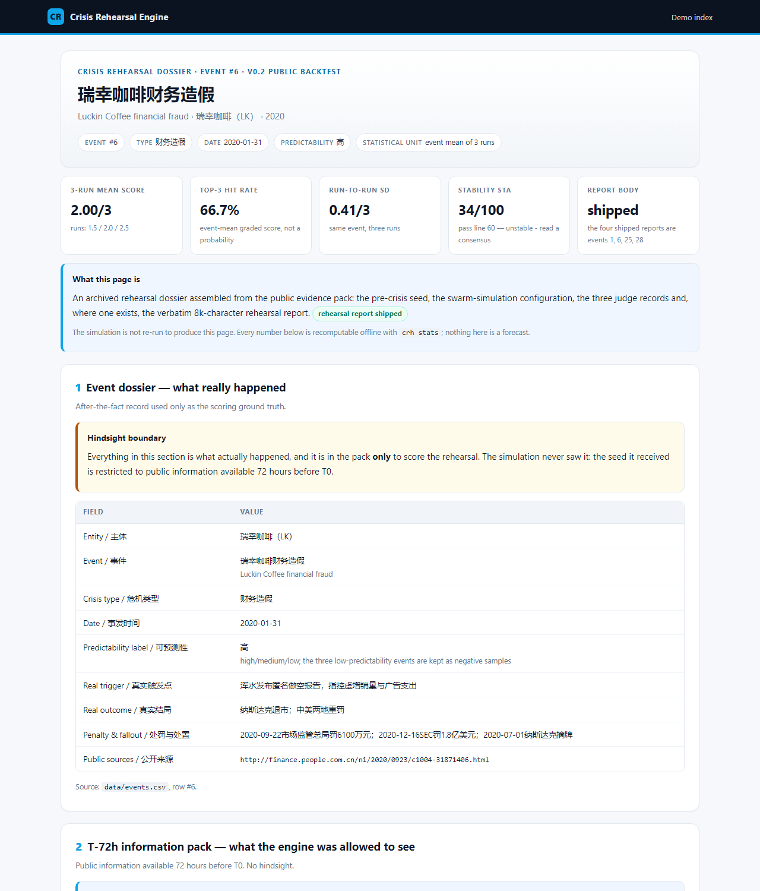
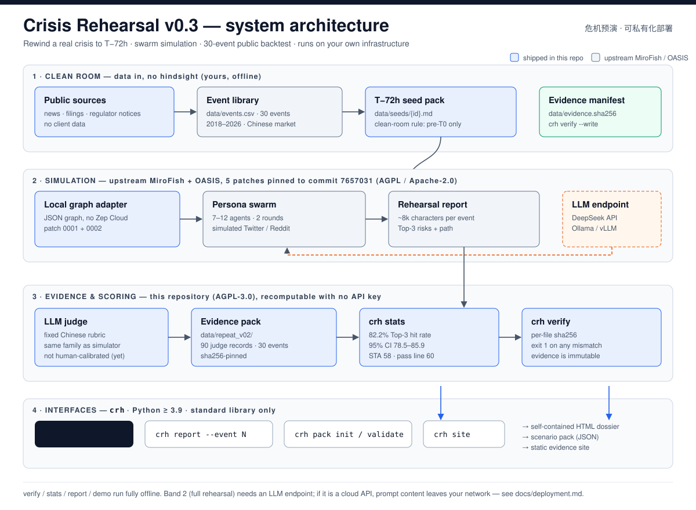

# 危机预演（Crisis Rehearsal）— 在危机发生前 72 小时，把它先演一遍

**把危机提前 72 小时演一遍：群体模拟 + 30 起公开企业危机回测，可私有化部署。**

危机预演把一起真实的公开危机倒回到爆发前 72 小时，只给模拟引擎当时公开可得的信息，让 7–12 个虚拟角色在模拟社交信息流里演化两轮，生成预演报告，再用固定评分规则与真实结局对照。公开回测的 Top-3 风险命中率是 **82.2%**（事件均值分级分，95% 置信区间 78.5–85.9，30 起事件 × 3 次运行）——这是**方向性证据，不是预测**。全部证据随仓库发布，**不需要 API key 就能复算**。English: [README.md](README.md)。

[](docs/cli.md)
[](LICENSE)
[](pyproject.toml)
[](data/repeat_v02/ci_summary.md)

## 30 秒快速开始（零 API key，完全离线）

```bash
pipx install git+https://github.com/yepinggu66/crisis-rehearsal   # 或：git clone … && pip install -e .
crh demo --out demo
```

`crh demo` 会校验证据包、复算已发布数字，并在 `demo/` 下生成 **4 份自包含 HTML 预演档案 + 索引页**。Python ≥ 3.9，只用标准库，不联网，不需要密钥。

- `crh stats` → 82.2%、95% 置信区间 78.5–85.9、同一事件三次运行的组内标准差 0.26/3、5/30 起事件三次完全一致、稳定性 STA 58（低于我们自己定的及格线 60——我们把这件事也写出来）。
- `crh verify` → 按 `data/evidence.sha256` 逐文件校验；任何一个证据文件被改动就返回非零。
- `crh report --event 1 --out dossier.html` → 生成单份档案；`crh pack init` / `crh pack validate` → 用你自己的 T-72h 场景包；`crh site` → 静态证据站。

命令参考：[docs/cli.md](docs/cli.md) · 终端实录：[docs/assets/cli-demo.txt](docs/assets/cli-demo.txt)。



*一张生成的预演档案。图片未显示也不影响阅读：`crh demo` 会生成同样的内容，命令说明见 [docs/cli.md](docs/cli.md)。*

## 它解决什么问题

声誉危机的黄金处置窗口是前 24 小时，但企业真正长期购买的是**监测**——事情发生之后才看到。预算都花在响应侧，而「事情发生之前先演一遍」没有主。这个项目把预演做成能跑的东西：一起真实事件、一份干净的 T-72h 情报包、几个被模拟的利益相关方，以及对照真实结局的固定评分。

对大集团/政府读者，价值不在「AI 能不能预测」，而在于三件更具体的事：**能不能私有化**（能，`crh` 全离线）、**数据出不出域**（默认不出，除非你显式配置云端模型）、**报告能不能上会**（单文件 HTML 档案，含证据哈希与诚实局限页）。

**先看诚实边界：** 评分器是 LLM、**尚未做人工校准**；只有 **17%** 的事件三次运行得分完全一致；稳定性指标**没有达到我们自设的及格线**；语料只有 30 起、以中国市场为主。引用任何数字前请先读 §诚实边界。

## 它如何工作

1. **T-72h 洁净室**——`data/seeds/{id}.md` 只包含 72 小时前公开可得的信息，不含结局、处罚、股价反应（规则见 `docs/methodology.md` 第 1 节）。
2. **本地图数据库**——用本地 JSON 适配器替换 Zep Cloud（补丁 `0001`/`0002`），不依赖任何云图服务。
3. **群体模拟**——7–12 个角色（记者、投资者、监管、做空机构、竞争对手等）在模拟社交信息流中演化 2 轮，模型可用 DeepSeek 或任意 OpenAI 兼容端点。
4. **预演报告**——约 8000 字：事件档案、升级路径、Top-3 风险。
5. **固定评分**——LLM 评分器把 Top-3 与 `data/events.csv` 中的真实结局对照（`yes`=1 / `partial`=0.5 / `no`=0）。
6. **证据**——90 条评分记录带哈希；`crh stats` 复算数字，`crh verify` 证明证据未被改动。



架构、数据契约、与上游 MiroFish 的关系：[docs/architecture.md](docs/architecture.md) · 架构图：[docs/assets/architecture.svg](docs/assets/architecture.svg)。

## 回测证据（v0.2，30 起事件 × 3 次）

| 指标 | 数值 | 出处 |
|---|---|---|
| 事件 / 运行次数 | 30 起中国公开企业危机（2018–2026）/ **90 次**（每起 3 次，全部完成） | `data/repeat_v02/ci_summary.md` |
| **Top-3 风险命中率**（事件均值） | **82.2%**（均值 2.47/3） | 同上 |
| 95% 置信区间 | **78.5–85.9%**（t 分布，df=29）；bootstrap 78.7–85.6% | 同上 |
| 与 v0.1 的配对差异 | −0.02/3（±0.18）——v0.1 单次结果得到复现 | 同上 |
| 组内标准差 | **0.26/3**（中位数 0.24）；组间标准差 0.30/3 | 同上 |
| 三次运行完全一致的事件 | **5/30 = 17%** | 同上 |
| 稳定性 STA（条目一致度、CV、Kendall W） | **58**——及格线 60、资助线 75 → **未通过** | `data/repeat_v02/sta_summary.md` |
| 预警质量分 | 78/100（范围 75–81） | `data/repeat_v02/ci_summary.md` |
| 单次成本 / 时间 | 约 $0.03（DeepSeek API）/ 约 4 分钟 | `data/repeat_v02/README.md` |

数字的读法本身就是纪律：82.2% 是**事件均值分级分**，不是二值命中率（30 起事件做二值口径约 ±17 个百分点）；90 次运行**不是** 90 个独立样本，统计单元是 30 起事件。失败案例连同复盘一起公布：[`data/failures.md`](data/failures.md)。完整样例报告：[`docs/reports/1.md`](docs/reports/1.md)、[`docs/reports/28.md`](docs/reports/28.md)、[`data/reports/6.md`](data/reports/6.md)、[`data/reports/25.md`](data/reports/25.md)。

## 企业版

买方简报（角色、典型场景、交付物、开放核心边界、30/60/90 天试点路径）：[docs/enterprise/overview.md](docs/enterprise/overview.md)。安全设计（STRIDE、默认不出域、审计与 RBAC 设计，**设计说明、非测评结论**）：[docs/enterprise/security.md](docs/enterprise/security.md)。采购应答包（验收标准、SLA 模板、报价结构示例、POC、DPA 要点、15 条采购问答）：[docs/enterprise/procurement.md](docs/enterprise/procurement.md)。

买方第一天就能做的事，不需要先相信我们：在自己的机器上离线安装，跑 `crh verify` / `crh stats` / `crh demo`，读失败案例，把数字和 `data/` 对照。

## 政府 / 公共部门

面向政务舆情、公共安全、食品安全、应急会商等场景的 T-72h 桌面推演：分级分类、涉密/非涉密隔离、信创适配 roadmap、与舆情监测/应急指挥系统的文件级对接、试点流程——见 [docs/government.md](docs/government.md)。**这是设计稿：没有政府采购案例、未列入任何采购目录、未做等保测评，不支持涉密环境。**

## 私有化部署与合规

三种形态——离线证据工作站、私有云、完全 air-gap——以及模型选择（DeepSeek API / Ollama / vLLM）、硬件与成本透明测算：[docs/deployment.md](docs/deployment.md)。`crh verify/stats/report/demo` 这条路径**不发起任何网络请求**；云端模型端点是显式选择，也是唯一的出域路径。

合规按**要求映射 + 差距清单**写，不是认证：等保 2.0 三级、数据安全法、个人信息保护法、GDPR、ISO 27001、SOC 2——[docs/enterprise/compliance.md](docs/enterprise/compliance.md)。**未认证、未测评、无政府安全评估。**

## 诚实边界

- **评分器是 LLM**，提示词与阈值固定，但**尚未人工校准**（计划与模板见 `data/judge_calibration.md`）。95% 置信区间按构造不含评分器误差。
- **评分器判「风险类型」，不判后果量级。** 方向对但量级错的预演仍可能得 2.5/3（`data/failures.md` #6、#8）。
- **主要错误是「虚假升级」**——「法律施压 / 甩锅供应商」这类从未发生的分支。它是系统性的，所以 82.2% 没有被「幸运凑数」抬高。
- **30 起事件太小。** 二值口径在 95% 置信度下约 ±17 个百分点；语料以中国市场 2018–2026 为主，泛化能力未被证明。
- **没有对照组**：没有人类分析师基线、没有消融实验。82.2% 只说明流程与固定评分规则的关系，不说明它比分析师强。
- **只有 17% 的事件多次运行稳定。** 单次运行的单事件分数是噪声；我们的交付规则是跑 3–5 次、读共识、不读最好的一次。
- **模拟只有 2 轮**，是成本妥协：足以产生升级路径和正确的问题，但不是社会模型。
- **v0.1 的 agent 访谈全部为空**（0/19 次访谈）；Top-3 依据的是图谱关系与传播路径，不是模拟角色的第一人称证词。v0.2 未重跑该步骤。
- **90 份生成的报告不随仓库发布**（每份约 8400 字）；只发布评分记录和 4 份样例。你可以复算每个统计量，但不能仅凭本仓库独立重新评分。
- **这是回测，不是预测。** 没有概率、没有「我们知道接下来会发生什么」、没有准确率保证。

## 仓库结构

```
data/events.csv              # 30 起公开危机：触发、结局、处罚、来源、可预测性
data/seeds/{id}.md           # T-72h 情报包（已冻结；只含 T0 前信息）
data/repeat_v02/             # 90 条评分记录、v0.1 基线、条目合并、生成的汇总
data/failures.md             # 我们失败的案例与复盘
data/judge_calibration.md    # 人工校准：状态「未运行」，只有模板与流程
patches/000*.patch           # 针对上游 MiroFish commit 7657031 的 5 个补丁
scripts/                     # v0.1/v0.2 流水线与统计脚本（统计脚本仅标准库）
crisis_rehearsal/            # v0.3 CLI（crh）：verify / stats / report / demo / pack / site
docs/                        # 架构、部署、企业/政府文档、样例报告、方法论
```

## 复现，两级

**A. 复算数字（快速开始已经做了）。** `crh verify`、`crh stats`、`crh demo`。v0.2 脚本仍可无 API key 运行：`python scripts/ci_stats.py --out data/repeat_v02`、`python scripts/sta_stats.py --out data/repeat_v02`。

**B. 重跑整张网格（需要 MiroFish + LLM key）。** 固定上游 commit、5 个机械补丁，然后 90 次运行（约 6 小时、数美元 API 费用）：

```bash
git clone https://github.com/666ghj/MiroFish && cd MiroFish
git checkout 7657031ac01184afe2cb220f5ee3545573b5e843
git apply ../patches/000*.patch            # PowerShell 写法见 docs/patches.md
npm run setup:all && cp .env.example .env  # 再填 4 个 LLM_* 变量（见 docs/patches.md）
cd .. && pip install -r requirements.txt
python scripts/repeat_runs.py --runs 3 --rounds 2 --out output_v2
python scripts/score_repeat.py --out output_v2
```

再用 `python scripts/cluster_items.py --out output_v2` 与 `python scripts/sta_stats.py --out output_v2` 重新导出 STA。完整链路、参数、固定 commit 校验：[docs/patches.md](docs/patches.md)。

## 许可与商业边界

- **代码：AGPL-3.0**，与上游 MiroFish 一致。可以运行、修改、作为服务提供；但若修改后通过网络对外提供服务，须公开你的修改源码。
- **我们保持闭源的部分：** 行业本体（角色规则）、客户语料、交付手册。**我们卖的是预演报告与工作坊，不是软件本身。** 开放核心边界见 [docs/enterprise/overview.md](docs/enterprise/overview.md) 第 6 节。
- **仓库内没有任何客户数据。** 所有事件都是公开新闻；情报包只依据公开来源编写。

## 引用

研究或报告中使用，请通过 [`CITATION.cff`](CITATION.cff) 引用。引用指标时请保留完整措辞：「Top-3 风险命中率 82.2%，事件均值分级分，30 起事件 × 3 次运行，**方向性证据，不是预测**」。

## 试点与联系

开 issue，或邮件 **yepinggu@outlook.com**。我们愿意为你的团队免费做一次 30 分钟的真实历史事件预演——如果方法不适合你的场景，我们会直说。中文站点：https://pingguye.cn。维护者：[@PingguYe](https://x.com/PingguYe)。

---

*构建于 [MiroFish](https://github.com/666ghj/MiroFish)（AGPL-3.0）与 [OASIS](https://github.com/camel-ai/oasis)（Apache-2.0）。文档索引：[docs/README.md](docs/README.md)。中英文数字以 `data/` 与英文主文档为准；如有出入，以 `data/` 为准。*
