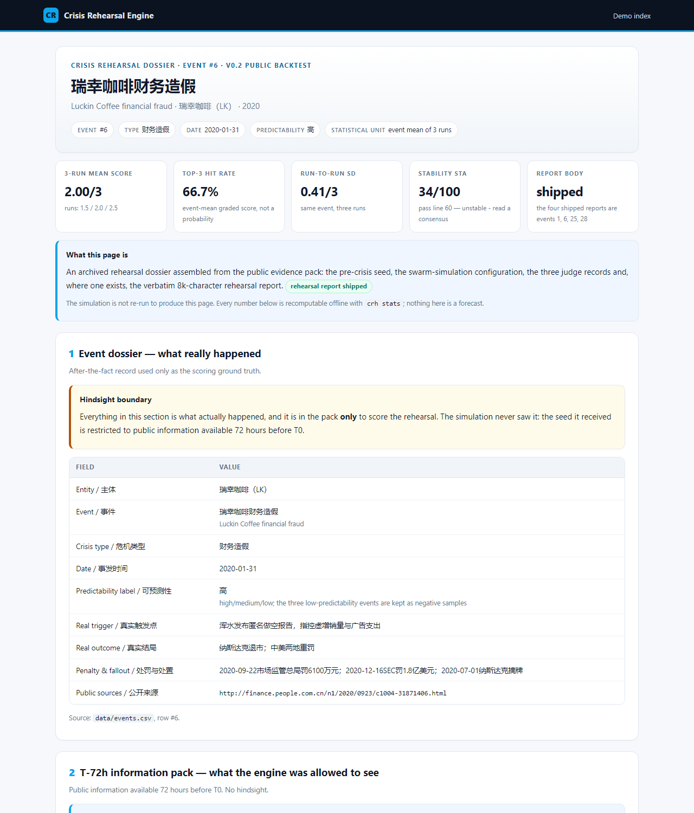
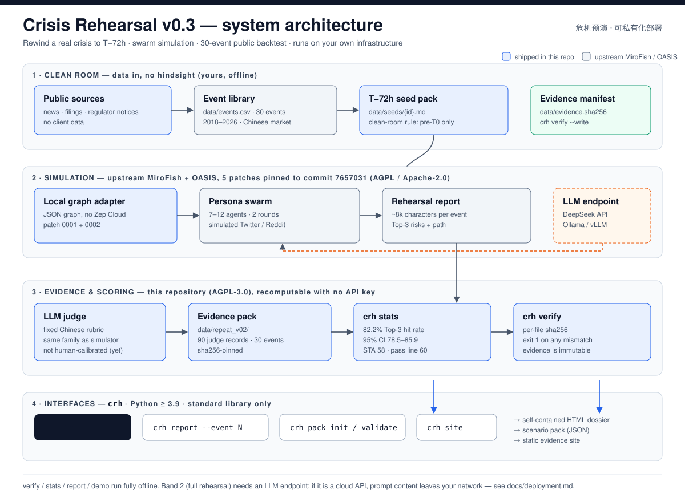

# Crisis Rehearsal — rehearse the crisis 72 hours before it happens

**Rehearse the crisis 72 hours before it happens — swarm simulation + 30-event public backtest, runs on your own infrastructure.**

Crisis Rehearsal rewinds a real reputation crisis to T−72h, gives a swarm-simulation engine only what was publicly known at that moment, and scores the rehearsal's Top-3 risks against what actually happened. The public backtest is **82.2%** (event-mean graded score, 95% CI 78.5–85.9, 30 events × 3 runs) — directional evidence, not a prediction. Everything is shipped and recomputable without an API key. 中文版：[README-ZH.md](README-ZH.md).

[](docs/cli.md)
[](LICENSE)
[](pyproject.toml)
[](data/repeat_v02/ci_summary.md)

> **Architecture Update (2026-11-23):** All upstream external framework patches (`patches/`, `docs/patches.md`) have been removed. Our commercial engine (**Crisis Rehearsal Pro V0.5**, private build) is now **100% in-house built** with zero upstream dependency (explicit 8×8×72 dynamics, walk-forward numeric gate, distribution-only Oracle protocol, and 90-minute boardroom workshop console). This public repository serves as our **verifiable offline evidence workstation** and **public case-study library**:
> - ⚡ [**NEW (Nov 25, 2026) — Jensen Huang's Reinstatement & The Jensen–Musk Alliance: Market, Silicon Valley, U.S. Policy & High-End Silicon Stress Test**](case_studies/nvda_jensen_return_musk_alliance_rehearsal.md) · [Interactive 90-Min Boardroom Workshop Console (Live Demo)](https://pingguye.cn/crisis-demo/jensen-musk-workshop.html) · [Executive Brief (ZH Live)](https://pingguye.cn/crisis-demo/jensen-musk-rehearsal.html)
> - 📊 [**Saving NVIDIA ($NVDA): Post-Jensen 72h Boardroom Crisis Rehearsal**](case_studies/nvda_post_jensen_boardroom_rehearsal.md)
> - 📈 [**$BTC 900-Day Walk-Forward Gate & Exchange 72h Bank-Run Rehearsal**](case_studies/btc_exchange_72h_bankrun_rehearsal.md)
> - 🎬 [**PROMETHEUS & SILICON: Dual-Timeline Tech Thriller & Pre-Production Audit**](case_studies/prometheus_and_silicon_pitch_and_rehearsal.md)

## 30-second quick start — zero API key, fully offline

```bash
pipx install git+https://github.com/yepinggu66/crisis-rehearsal   # or: git clone … && pip install -e .
crh demo --out demo
```

`crh demo` verifies the evidence pack, recomputes the published statistics, and writes **four self-contained HTML rehearsal dossiers + an index** into `demo/`. Python ≥ 3.9, standard library only, no network calls, no key.

- `crh stats` → 82.2%, 95% CI 78.5–85.9, within-event SD 0.26/3, 5/30 events identical, STA 58 (below our own pass line of 60 — yes, we publish that).
- `crh verify` → checks `data/evidence.sha256` and exits 1 if any evidence file was edited.
- `crh report --event 1 --out dossier.html` → one dossier; `crh pack init` / `crh pack validate` → your own T-72h scenario; `crh site` → static evidence site.

Command reference: [docs/cli.md](docs/cli.md) · terminal transcript: [docs/assets/cli-demo.txt](docs/assets/cli-demo.txt).



*A generated dossier. If the image does not render, the same output is demonstrated by `crh demo` and described in [docs/cli.md](docs/cli.md).*

## Why this exists

A reputation crisis is decided in the first 24 hours, and most companies only buy **monitoring** — after the fact. The budget exists on the response side; the rehearsal that should happen *before* does not have one. This project makes the rehearsal runnable: a real event, a real T−72h information pack, simulated stakeholders, and a fixed score against the documented outcome.

**What we are honest about:** the judge is an LLM and is **not human-calibrated**; only **17%** of events score identically across three runs; our stability metric **fails its own pass line**; the 30-event corpus is small and Chinese-market. See §Honest limitations before quoting any number.

## How it works

1. **T−72h clean room** — `data/seeds/{id}.md` contains only what was public 72 hours before T0. No hindsight, no post-T0 facts (`docs/methodology.md` §1).
2. **Local graph** — the Zep Cloud dependency is replaced by a local JSON adapter (patch `0001` + `0002`); no cloud graph service.
3. **Swarm simulation** — 7–12 persona agents (journalists, investors, regulators, short sellers, competitors) react for 2 rounds on a simulated social feed, driven by DeepSeek or any OpenAI-compatible model.
4. **Rehearsal report** — ~8k characters: event file, escalation paths, Top-3 risks.
5. **Scoring** — a fixed LLM judge compares Top-3 against the documented outcome (`yes`=1 / `partial`=0.5 / `no`=0).
6. **Evidence** — 90 judge records, hashed; `crh stats` recomputes the published numbers, `crh verify` proves nothing was edited.



Architecture, data contracts and upstream relationship: [docs/architecture.md](docs/architecture.md) · diagram: [docs/assets/architecture.svg](docs/assets/architecture.svg).

## Backtest evidence (v0.2, 30 events × 3 runs)

| Metric | Value | Source |
|---|---|---|
| Events / runs | 30 Chinese public crises (2018–2026) / **90** (3 per event, all completed) | `data/repeat_v02/ci_summary.md` |
| **Top-3 risk hit rate** (event mean) | **82.2%** (mean 2.47/3) | same |
| 95% CI | **78.5–85.9%** (t, df=29); bootstrap 78.7–85.6% | same |
| Paired diff vs v0.1 | −0.02/3 (±0.18) — the v0.1 single-run result reproduced | same |
| Within-event SD | **0.26/3** (median 0.24); between-event SD 0.30/3 | same |
| Events identical across all 3 runs | **5/30 = 17%** | same |
| Stability STA (item agreement, CV, Kendall W) | **58** — pass line 60, funding line 75 → **failed** | `data/repeat_v02/sta_summary.md` |
| Early-warning quality | 78/100 (range 75–81) | `data/repeat_v02/ci_summary.md` |
| Cost / time per run | ~$0.03 (DeepSeek API) / ~4 minutes | `data/repeat_v02/README.md` |

The scoring discipline is part of the number: 82.2% is an **event-mean graded score**, not a binary hit rate (binary framing on 30 events is roughly ±17pp); the 90 runs are **not** 90 independent samples — the unit is 30 events. Failures are published with post-mortems in [`data/failures.md`](data/failures.md). Sample reports: [`docs/reports/1.md`](docs/reports/1.md), [`docs/reports/28.md`](docs/reports/28.md), [`data/reports/6.md`](data/reports/6.md), [`data/reports/25.md`](data/reports/25.md).

## Enterprise

Buyer brief, roles, scenarios, deliverables, open-core boundary and a 30/60/90-day pilot: [docs/enterprise/overview.md](docs/enterprise/overview.md). Security design (STRIDE, default no-egress, audit/RBAC design — *design notes, not an assessment*): [docs/enterprise/security.md](docs/enterprise/security.md). Procurement pack (acceptance criteria, SLA template, price-structure example, POC, DPA points, 15 FAQs): [docs/enterprise/procurement.md](docs/enterprise/procurement.md).

What a buyer can do on day one, without trusting us: install offline, run `crh verify` / `crh stats` / `crh demo` on their own hardware, read the failures file, and compare the numbers to `data/`.

## Government / public sector

政务舆情、公共安全、食品安全、应急会商等场景的 T−72h 桌面推演：分级分类、涉密/非涉密隔离、信创适配 roadmap、与舆情监测/应急指挥系统的文件级对接、试点流程 — [docs/government.md](docs/government.md). **This is a design note: there are no government procurement cases, no catalogue entry, no 等保 assessment, and classified deployments are not supported.**

## Private deployment & compliance

Three shapes — offline evidence workstation, private cloud, air-gap — with model choices (DeepSeek API / Ollama / vLLM), sizing and cost transparency: [docs/deployment.md](docs/deployment.md). The `crh verify/stats/report/demo` path makes **no network calls**; a cloud model endpoint is an explicit opt-in and the only egress path.

Compliance is documented as a **requirement mapping with gaps**, not a certification: 等保 2.0 三级, 数据安全法, 个保法, GDPR, ISO 27001, SOC 2 — [docs/enterprise/compliance.md](docs/enterprise/compliance.md). **No certification, no测评, no government assessment.**

## Honest limitations

- **The judge is an LLM**, fixed prompt and thresholds, but **not human-calibrated**: no human spot-check has been run yet (protocol in `data/judge_calibration.md`). The 95% CI excludes judge error by construction.
- **The judge grades risk type, not consequence severity.** A rehearsal that names the right risk at the wrong scale can still score 2.5/3. Visible in [`data/failures.md`](data/failures.md) (#6, #8).
- **The dominant error is a false escalation** — "legal pressure / blame the supplier" branches that never happened. It is systematic, so the headline is not inflated by lucky padding.
- **30 events is small.** Binary framing gives roughly ±17pp at 95%. The corpus is Chinese-market, 2018–2026; generalization is unproven.
- **No control condition**: no human-analyst baseline, no ablation. 82.2% describes the pipeline against a fixed rubric; it does not show that it beats an analyst.
- **Only 17% of events are stable across runs.** A single-run score on a single event is noise; our delivery rule is 3–5 runs read as a consensus.
- **2 rounds of simulation** is a cost compromise: enough for escalation paths and the right questions, not a model of society.
- **Agent interviews came back empty in the v0.1 grid** (0/19 interviews); the Top-3 rests on graph relations and propagation paths, not first-person testimony. Not re-run on v0.2.
- **The 90 generated reports are not shipped** (~8.4k chars each); only the judge records plus four samples. You can recompute every statistic; you cannot independently re-judge from this repo alone.
- **This is a backtest, not a forecast.** No probability, no "we know what happens next", no accuracy guarantee.

## Repository layout

```
data/events.csv              # 30 public crises: trigger, outcome, penalty, sources, predictability
data/seeds/{id}.md           # T-72h information packs (frozen; pre-T0 only)
data/repeat_v02/             # 90 judge records, v0.1 baseline, item merge, generated summaries
data/failures.md             # the events we lost, with post-mortems
data/judge_calibration.md    # human calibration: status NOT RUN; template only
case_studies/                # full English V0.5 dossiers ($NVDA, $BTC, PROMETHEUS & SILICON)
scripts/                     # v0.1/v0.2 statistics scripts (stdlib for stats)
crisis_rehearsal/            # offline evidence CLI (crh): verify / stats / report / demo / pack / site
docs/                        # architecture, deployment, enterprise/government, reports, methodology
```

## Reproduce offline

Run `crh verify`, `crh stats`, and `crh demo` completely offline with zero API keys. The v0.2 statistics scripts remain runnable with no API key: `python scripts/ci_stats.py --out data/repeat_v02` and `python scripts/sta_stats.py --out data/repeat_v02`.

*(All legacy upstream fork/patch dependencies have been removed. Live simulations now run on our 100% proprietary **Crisis Rehearsal Pro V0.5** private engine.)*

## License & commercial boundary

- **Public Evidence Workstation (`crisis-rehearsal`)**: `AGPL-3.0`. Inspect, audit, and reproduce the 30-event historical backtest offline.
- **Commercial Private Engine (`Crisis Rehearsal Pro V0.5`)**: 100% in-house clean-room codebase with zero upstream dependency — available for enterprise annual licensing, PR agency white-label pilots, and 90-minute executive workshops.
- **No client data in this repo.** All events are public news; seeds were written from public sources only.

## Cite

If you use this in research or a report, cite it via [`CITATION.cff`](CITATION.cff). Please quote the metric with its wording: "Top-3 risk hit rate 82.2%, event-mean graded score, 30 events × 3 runs, **directional evidence, not a forecast**".

## Pilot & contact

Open an issue, or email **yepinggu@outlook.com**. We will run a free 30-minute rehearsal of one real past event for your team — and we will tell you honestly if the method does not fit your case. Chinese site: https://pingguye.cn. Maintainer: [@PingguYe](https://x.com/PingguYe).

---

*Documentation index: [docs/README.md](docs/README.md).*
