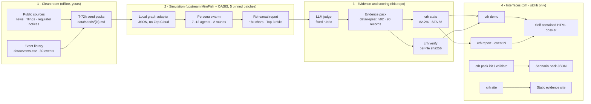

# Architecture

> What runs where, what leaves your network, and where you can extend it.
> Companion diagram: [`docs/assets/architecture.svg`](assets/architecture.svg).
>
> Status honesty: the **evidence workstation** (`crh verify / stats / report / demo`), the
> evidence pack and the scenario-pack schema are shipped in this repository (v0.3.0). The
> **full rehearsal pipeline** is upstream MiroFish + OASIS plus the five patches in
> `patches/` — it is documented and reproducible, but it is not vendored here. Items marked
> **roadmap** are design, not code.

## 1. The whole system in one picture

Two rules hold the design together:

1. **The future never enters the clean room.** A seed pack may only contain what a careful
   analyst could have known 72 hours before T0. `docs/methodology.md` §1 lists the review
   rules; `data/seeds/` is the frozen official set. v0.2.2 swept out 91 authoring placeholders
   and any clause that described a post-T0 outcome.
2. **Evidence is immutable and pinned.** `data/repeat_v02/scores.jsonl` (90 records) and its
   baseline are hashed in `data/evidence.sha256`. `crh verify` recomputes the hashes and exits
   non-zero on any edit, so a "reproduce the numbers" claim can be checked by the buyer.

## 2. Layers and components

| Layer | Component | Where it lives | Shipped / upstream | Notes |
|---|---|---|---|---|
| 1 Clean room | Event library (30 events, 2018–2026) | `data/events.csv` | shipped | Outcomes, penalties, source URLs; three **low-predictability** events are kept as negative samples |
| 1 Clean room | T-72h seed packs | `data/seeds/{id}.md` | shipped | Written from public sources only; auditable, not "complete" |
| 1 Clean room | Scenario-pack tooling | `crh pack init / validate`; `schema/scenario_pack.schema.json` | shipped (v0.3) | Lets an enterprise author its own T-72h pack without touching the public corpus |
| 2 Simulation | Local graph adapter | `patches/0001`, `0002` | patch against upstream | Replaces the Zep Cloud dependency with a local JSON store (~441 lines, new file) |
| 2 Simulation | Deterministic config + no-wait hooks | `patches/0003`–`0005` | patch against upstream | Ontology override, fixed simulation template, OASIS `--no-wait` |
| 2 Simulation | Swarm simulation + report agent | [MiroFish](https://github.com/666ghj/MiroFish) + [OASIS](https://github.com/camel-ai/oasis) | upstream | 7–12 persona agents, 2 rounds, simulated Twitter/Reddit; ~8k-char report |
| 3 Judge | LLM judge, fixed Chinese rubric | `scripts/score.py`, `scripts/score_repeat.py` | shipped (v0.1/v0.2 scripts) | `yes`=1 / `partial`=0.5 / `no`=0; same model family as the simulator |
| 3 Evidence | Judge records + item merge + summaries | `data/repeat_v02/` | shipped | 90 records, v0.1 baseline, LLM item merge, generated summaries |
| 3 Stats | `ci_stats.py`, `sta_stats.py` algorithms | `scripts/` | shipped, stdlib only | Re-implemented behind `crh stats`; numbers are asserted by tests |
| 3 CLI | `crh` | `crisis_rehearsal/` | shipped (v0.3) | `verify`, `stats`, `report`, `demo`, `pack`, `site`; stdlib only, Python ≥ 3.9 |
| 3 Packaging | Enterprise RBAC / audit log / SSO | — | **roadmap** | See `docs/enterprise/security.md`; not in the open-source CLI |

The CLI deliberately **imports and reuses** the v0.2 statistics logic instead of forking it.
The published figures — 82.2% event-mean Top-3 hit rate, 95% t-CI 78.5–85.9 (bootstrap
78.7–85.6), within-event SD 0.26/3, 5/30 events identical, STA 58 below the pass line of 60 —
must come out of `crh stats` unchanged; `tests/` asserts them against `data/repeat_v02`.
Nothing in v0.3 introduces a new metric.

## 3. Data contracts

### 3.1 `data/events.csv` — the event library

One row per event. Columns: `id`, `event_name_en`, `event_name_zh`, `entity`, `year`, `date`,
`crisis_type`, `trigger`, `outcome`, `penalty`, `source_url`, `predictability` (高/中/低).
The row is the **ground truth** supplied to the judge. `source_url` is part of the evidence:
an event without a public source does not enter the library.

### 3.2 `data/seeds/{id}.md` — the T-72h information pack

Free-form Markdown, but the expected sections are stable:

- entity and recent public disclosures;
- the trigger (recall notice, complaint cluster, policy draft, public conflict);
- early signals (small-scale discussion, prior incidents, regulatory signals);
- three scenario hypotheses (silence / apology / confrontation);
- a provenance line naming the public sources used.

Rules: no post-outcome facts, no penalties, no stock reactions, no information published
after T0; when in doubt, omit. See `docs/methodology.md` §1. The seed is the *only* input to
the simulation — it is also the most likely place for a future leak, which is why seed review
is part of `CONTRIBUTING.md`.

### 3.3 `data/repeat_v02/scores.jsonl` — one record per run (90 records)

| Field | Meaning |
|---|---|
| `id` | Event id, 1–30, joins `events.csv` and `seeds/{id}.md` |
| `run` | Repeat index `"1"`–`"3"` |
| `name` | Event name copied from the event library at scoring time |
| `md5` | First 10 hex chars of the md5 of the 7,000-char report excerpt judged — ties a record to a report that is not public |
| `top3` | Three ranked risks: `rank`, `risk` (report wording), `hit` (`yes`/`partial`/`no`), `why` (judge justification vs. outcome) |
| `path_hit` | Whether the propagation path matches the real key nodes |
| `early_warning` | 0–100; missing for a couple of runs where the judge omitted it |
| `comment` | One-sentence overall verdict |

Scoring: `yes`=1, `partial`=0.5, `no`=0 → a run scores 0–3; the headline is the mean over
events of the per-event mean score / 3. The statistical unit is the **event** (30), not the
run (90); repeats estimate run-to-run noise. `data/repeat_v02/README.md` is the authoritative
schema note.

### 3.4 Scenario pack (v0.3) — `crh pack init` / `crh pack validate`

A customer-authored rehearsal scenario, schema-validated (`schema/scenario_pack.schema.json`).
Top-level fields:

| Field | Purpose |
|---|---|
| `pack_version` | Schema version, currently `0.3` |
| `meta` | `id`, `name`, `sector` (`enterprise` / `government` / `finance`), `jurisdiction`, `classification`, `lang` |
| `timeline` | `T-72h` … `T+7d` slots: what was known / what was decided when |
| `stakeholders[]` | Roles the simulation should model (regulator, media, customers, employees …) |
| `regulatory_triggers[]` | Which rules or reporting duties the pack assumes |
| `escalation_ladder[]` | Foreseeable escalation steps, ordered |
| `kpis[]` | What a good rehearsal outcome means for this organisation |
| `decision_log[]` | Decisions and owners to exercise in the tabletop |
| `evidence[]` | Sources for every factual claim in the pack |
| `provenance` | Author, date, review status, clean-room attestation |

A pack with a post-T0 fact is invalid by review, not by schema — the schema cannot prove a
clean room, so validation prints a reminder. Use `crh pack validate <path>` before sharing.

### 3.5 Integrity manifest — `data/evidence.sha256`

One line per evidence file: `<sha256>  <relative path>`. Produced with `crh verify --write`,
checked with `crh verify` (exit 0 = all OK, exit 1 = mismatch or missing file). The manifest
itself is committed, so an edit to any covered file shows up in a diff *and* in the output of
`crh verify`.

## 4. Deployment topologies

| Shape | What runs there | Network | Doc |
|---|---|---|---|
| Offline evidence workstation | `crh verify/stats/report/demo/pack/site` | none required | [deployment.md §2](deployment.md#2-shape-a--offline-evidence-workstation) |
| Private cloud | Above + model gateway (vLLM/Ollama) + MiroFish service | internal only | [deployment.md §3](deployment.md#3-shape-b--private-cloud-docker-compose) |
| Air-gap | Same as private cloud, media-based updates | physically isolated | [deployment.md §4](deployment.md#4-shape-c--air-gapped-installation) |

The trust boundary that matters is not the container: it is **the model endpoint**. If the
rehearsal pipeline is pointed at a cloud LLM API, the seed pack, simulated posts and the
report excerpt are sent to that endpoint. `docs/enterprise/security.md` §2 traces every hop.

## 5. Extension points

- **New public events** — add a row to `data/events.csv`, author a T-72h pack under
  `data/seeds/`, then re-run the full grid. Data PRs follow `CONTRIBUTING.md` (clean-room
  review; evidence files are never edited in place).
- **Your own scenarios** — author a scenario pack with `crh pack init --sector ...`, validate,
  and rehearse it against your own stakeholders, timeline and KPIs. Packs are customer data;
  they are not contributed upstream.
- **Models** — any OpenAI-compatible endpoint: DeepSeek API, Ollama, vLLM. The judge prompt
  is fixed so batches stay comparable; changing the simulator model invalidates comparability
  with the published grid, and we say so rather than pretending the percentage transfers.
- **Languages** — the event library and judge prompt are Chinese; an English corpus is a
  roadmap item. `meta.lang` in a scenario pack already carries the language tag.
- **Judge / rubric** — the H1/H2/H3 codes in `docs/methodology.md` §3 are the contract. A
  changed rubric requires re-scoring and re-publishing, not a footnote.
- **Interfaces** — the HTML dossier is a self-contained single file, so an integrator can
  archive it, attach it to a board memo, or serve it from an intranet without a build step.
  `crh site` gives a static index. There is no server-side API by design; **roadmap** items
  (audit-log export, SSO) are listed in `ROADMAP.md`.

## 6. Relationship to upstream MiroFish and OASIS

- **MiroFish** ([666ghj/MiroFish](https://github.com/666ghj/MiroFish), AGPL-3.0) is the
  simulation engine: knowledge graph, persona agents, report generation. We pin the work to
  upstream commit `7657031ac01184afe2cb220f5ee3545573b5e843` and ship five mechanical patches
  (`patches/`), verified with `git apply --check`. The patch set is documented in
  [patches.md](patches.md).
- **OASIS** ([camel-ai/oasis](https://github.com/camel-ai/oasis), Apache-2.0) provides the
  simulated social feed used by MiroFish. The benchmark sets the recommender to `random` and
  `HF_HUB_OFFLINE=1` so a run neither downloads a HuggingFace model nor hangs without
  network access; that is a deliberate cost/quality trade-off, not the upstream default.
- **What this repository adds**: the seed-authoring protocol, the local graph adapter
  patches, the fixed scoring protocol, the shipped evidence pack and the CLI/HTML layer.
  It does **not** re-license upstream code: because MiroFish is AGPL-3.0 and this repository
  is AGPL-3.0, running a modified version as a network service carries AGPL source
  obligations. `docs/enterprise/overview.md` explains the open-core boundary; if you need
  different terms, talk to the maintainers before deploying.

## 7. Non-goals

- Not a monitoring system: it does not ingest a live social feed and alert you.
- Not a forecast: it produces directional evidence about what *could* escalate, scored
  against what *did* happen in 30 past events.
- Not a multi-tenant SaaS: the open-source CLI is single-operator and file-based.
- Not a certified or assessed security product: see `docs/enterprise/compliance.md`.
