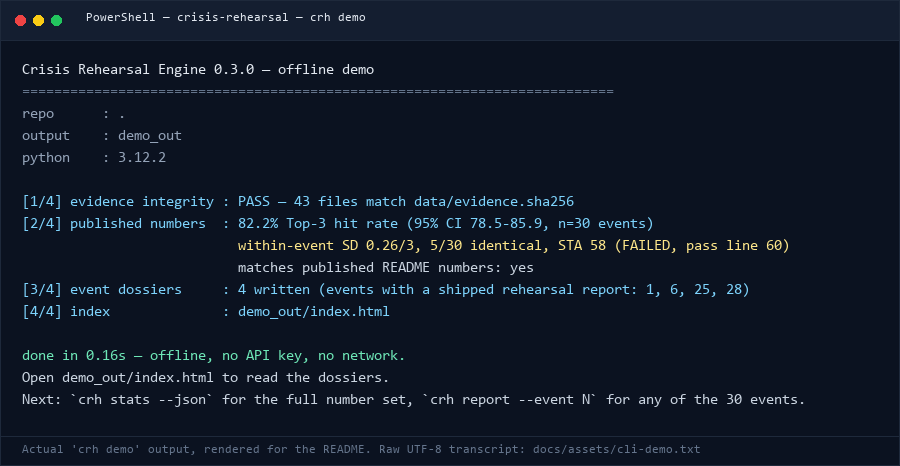

# `crh` — the Crisis Rehearsal Engine command line

One command gives you the public 30-event backtest, recomputed and rendered on
your own machine: **offline, no API key, no network, under ten seconds.**

```bash
pip install -e .     # zero runtime dependencies, Python >= 3.9
crh demo             # verify + stats + 4 dossiers + index -> demo_out/
```

This page is the full command reference. It documents what each command reads,
what it writes, what it refuses to do, and where every number comes from.

`crh` is the evidence workstation around the rehearsal pipeline. It does **not**
run the swarm simulation (that is MiroFish + an LLM key, see
[`docs/methodology.md`](methodology.md) and README "Reproduce it — level B").
It reads the artifacts that pipeline already produced and ships in
`data/repeat_v02/`.

---

## 1. Install

```bash
pip install -e .                  # CLI only; standard library only; no network needed at runtime
pip install -e ".[dev]"           # + pytest, for the test suite
pip install -e ".[llm]"           # + httpx, only to regenerate the 90-run grid (MiroFish runner + judge)
```

- Python **3.9 – 3.12**, Windows / Linux / macOS.
- Runtime dependencies: **none**. The CLI must run on an air-gapped workstation,
  so `dependencies = []` in `pyproject.toml` and a test enforces it.
- `pip install -e .` installs two identical entry points: `crh` and
  `crisis-rehearsal`. `python -m crisis_rehearsal` is equivalent.

Container (evidence workstation only, **not** the simulation engine):

```bash
docker build -t crisis-rehearsal:0.3.0 .
docker run --rm -v "$PWD/demo_out:/work/demo_out" crisis-rehearsal:0.3.0
docker compose run --rm evidence-station stats
```

---

## 2. Quick start (what a reader should run first)

```console
$ crh demo
Crisis Rehearsal Engine 0.3.0 — offline demo
==========================================================================
repo      : .
output    : demo_out
python    : 3.12.2

[1/4] evidence integrity : PASS — 43 files match data/evidence.sha256
[2/4] published numbers  : 82.2% Top-3 hit rate (95% CI 78.5-85.9, n=30 events)
                           within-event SD 0.26/3, 5/30 identical, STA 58 (FAILED, pass line 60)
                           matches published README numbers: yes
[3/4] event dossiers     : 4 written (events with a shipped rehearsal report: 1, 6, 25, 28)
[4/4] index              : demo_out/index.html

done in 0.16s — offline, no API key, no network.
Open demo_out/index.html to read the dossiers.
Next: `crh stats --json` for the full number set, `crh report --event N` for any of the 30 events.
```

The transcript above is the real output of `crh demo` on the release checkout and
is archived at [`docs/assets/cli-demo.txt`](assets/cli-demo.txt); the rendered
image below is that same transcript, not a mocked-up screenshot
([`docs/assets/cli-demo.png`](assets/cli-demo.png)).



**Why this is a proof and not a slide.** The demo first verifies the sha256
manifest, then recomputes every published number by importing
`scripts/ci_stats.py` and `scripts/sta_stats.py` from the checkout (it does not
copy their formulas), then renders the dossiers. If the evidence pack has
drifted by one byte, the demo fails instead of presenting numbers.

---

## 3. Commands

### `crh --version`

```console
$ crh --version
crh 0.3.0
```

### `crh verify [--repo PATH] [--write] [--quiet]`

Checks every file under `data/` against `data/evidence.sha256` (GNU-coreutils
layout: `<sha256>  <path>`). Four outcomes per file: `OK`, `MODIFIED`, `MISSING`,
`UNLISTED`; any non-`OK` row makes the command exit `1`.

```console
$ crh verify
Crisis Rehearsal Engine — evidence integrity (crh verify)
==============================================================================
repo     : .
manifest : data/evidence.sha256
files    : 43 listed

summary  : 43 OK, 0 modified, 0 missing, 0 unlisted
result   : PASS — the evidence pack matches data/evidence.sha256
```

`--write` regenerates the manifest from the files on disk. It is the **only**
command that writes inside `data/` and it rewrites exactly one file:

```console
$ crh verify --write
evidence manifest written: data/evidence.sha256 (43 files)
```

Regenerate the manifest only when you intentionally changed the evidence pack,
and review the diff before committing — the manifest is the audit trail that
makes "the numbers did not move" checkable.

**Line endings, and why the old hash differs.** `crh verify` hashes raw bytes.
The repository stores every text file as LF and checks it out as LF on all
platforms (`.gitattributes`: `* text=auto eol=lf`, `data/** text eol=lf`), so a
Windows checkout, a Linux checkout and a GitHub tarball of the same commit verify
against exactly the same bytes. The v0.2 evidence pack recorded `scores.jsonl`
as `sha256 562be6853fba6906` from a CRLF Windows working tree; the canonical value
in `data/evidence.sha256` is `0bfd42d4be1f16db`. No evidence file was edited to
produce this — the committed blobs have always been LF, only the checkout
conversion differed.

### `crh stats [--repo PATH] [--json] [--bootstrap N] [--seed N]`

Recomputes the published v0.2 statistics. The statistical unit is the **event**
(30), never the run (90).

```console
$ crh stats
Crisis Rehearsal Engine — published statistics (crh 0.3.0)
==============================================================================
repo            : .
scores          : data/repeat_v02/scores.jsonl  sha256 0bfd42d4be1f16db
item merge      : data/repeat_v02/item_clusters.json
events / runs   : 30 events x 3 runs per event = 90 runs
statistical unit: EVENT (repeats estimate run-to-run noise, they are not independent samples)

Headline (the numbers quoted in README.md)
------------------------------------------------------------------------------
  Top-3 risk hit rate (event mean) : 82.2%   [mean 2.47/3, n=30 events]
  95% CI, t-distribution (primary) : 78.5% - 85.9%   (df=29)
  95% CI, 10,000-sample bootstrap : 78.7% - 85.6%   (numpy, seed 20261026)
  Paired diff vs v0.1 single run   : -0.02/3   (±0.18, n=30 events)

Variance and stability
------------------------------------------------------------------------------
  Between-event SD                 : 0.30/3   (difficulty spread across events)
  Within-event SD (mean)           : 0.26/3   (same event, re-run)
  Within-event SD (median)         : 0.24/3
  Events identical in every run    : 5/30 = 17%
  Events with within SD >= 0.5     : 2/30 = 7%   (#21, #23)
  Events at a perfect 3/3, all runs: 0/30 (Wilson 0-11%)
  Events at a perfect 3/3, any run : 14/30 = 47%
  Runs scoring a perfect 3/3       : 21/90 = 23%   (descriptive only, runs are correlated)
  Early-warning quality            : 78/100   (75-81, event mean ± t)

Stability STA (internal template section 2.5)
------------------------------------------------------------------------------
  STA = 100 * [0.40*J-bar + 0.30*(1 - CV-bar) + 0.30*Kendall W]
  STA 58  ->  FAILED   (pass line 60, funding line 75)
  J-bar item agreement 0.54   CV-bar 0.08   Kendall W 0.29
  item merge: LLM semantic merge (cluster_items.py)

Published-number check
------------------------------------------------------------------------------
  [OK  ] hit_rate_pct             published 82.2     computed 82.2
  [OK  ] ci_t_low_pct             published 78.5     computed 78.5
  [OK  ] ci_t_high_pct            published 85.9     computed 85.9
  [OK  ] ci_bootstrap_low_pct     published 78.7     computed 78.7
  [OK  ] ci_bootstrap_high_pct    published 85.6     computed 85.6
  [OK  ] within_event_sd          published 0.26     computed 0.26
  [OK  ] identical_events         published 5        computed 5.0
  [OK  ] sta                      published 58       computed 58.0
  [OK  ] sta_jbar                 published 0.54     computed 0.54
  [OK  ] sta_cvbar                published 0.08     computed 0.08
  [OK  ] sta_w                    published 0.29     computed 0.29
  ...

Scoring discipline (do not quote the headline without these)
------------------------------------------------------------------------------
  1. 82.2% is an EVENT-MEAN GRADED SCORE, not a binary hit/miss rate.
     The binary framing on 30 events is roughly ±17pp; do not mix the two.
  2. 90 runs are NOT 90 independent samples; the unit is 30 events.
  3. The interval covers sampling and run randomness only. It does NOT include
     LLM-judge error or the systematic bias of a 2-round simulation.
  4. Only 5 of 30 events score identically across repeats: commit to a
     consistent level, never to 'the same conclusion every time'.
  5. This is a rehearsal/backtest producing DIRECTIONAL EVIDENCE, not a forecast.
```

`--json` emits the same computation, including per-event rows, for dashboards
and CI assertions:

```bash
crh stats --json > stats.json
python -c "import json; d=json.load(open('stats.json')); print(d['sta']['batch'], d['published_match'])"
# 57.95... True
```

`--bootstrap N` changes the resample count (default 10000, `0` disables). The
published interval used 10000 resamples and seed 20261026; a different count is
labelled in the output and deliberately fails the published-number check for
that row rather than silently substituting a new CI. numpy is used when it is
installed, otherwise a pure-Python fallback runs — the output says which one.

### `crh report --event ID [--repo PATH] [--out PATH]`

Renders one event as a **single self-contained HTML file**: inline CSS, no
JavaScript, no external assets, no web fonts. Open it from a USB stick on an
air-gapped machine, email it to legal, or archive it for a regulator.

```console
$ crh report --event 28 --out reports
event    : #28 西贝预制菜风波
report   : reports/event-28.html (56.8 KB, self-contained HTML: inline CSS, no JS, no external assets)
body     : shipped report included verbatim (docs/reports/28.md, sha256 c83b5d32bf58e610)
numbers  : event mean 2.83/3 (94.4%), STA 65/100 (mostly reproducible)
open     : reports/event-28.html
```

Every dossier contains:

| Section | Content |
|---|---|
| Event dossier | entity, type, date, predictability, real trigger, real outcome, penalty, public sources — **labelled as hindsight** |
| T-72h information pack | the seed the engine was allowed to see (`data/seeds/{id}.md`), clean-room rules stated |
| Simulation configuration | engine + pinned commit, local graph adapter, 7–12 personas, 2 rounds, judge prompt, cost/time, per-run report md5 |
| Top-3 risks vs real outcome | all three runs, each risk with the judge's verdict (`yes` / `partial` / `no`) and recorded reasoning |
| Three-run scores and stability | per-run scores, event mean, run-to-run SD, STA components (J̄, D, W, CV), verdict, disagreement flag |
| Evidence and sha256 provenance | full sha256 of every artifact the page was built from, plus the manifest integrity state |
| Honest limitations | the known weaknesses, in the order that matters for a buyer |
| Shipped rehearsal report | **only for events 1, 6, 25, 28**: the verbatim ~8k-character report, byte-for-byte |

**Events without a shipped report.** 26 of the 30 events do not ship the
generated rehearsal report (only `docs/reports/{1,28}.md` and
`data/reports/{6,25}.md` exist). Their dossiers contain the seed, the real
outcome and the three judge records — and state explicitly that no report body is
published. The CLI never fabricates report prose to make a page look complete.

```text
--out may be a .html file or a directory. Default: <repo>/reports/event-ID.html
```

### `crh demo [--repo PATH] [--out DIR]`

The offline proof path, described in §2. Steps: verify → stats → four dossiers
(events 1, 6, 25, 28) → `index.html`. Default output: `<repo>/demo_out/`.

Contract: no network call, no API key, no write outside `--out`, under 10 seconds
on a normal laptop (0.2 s here). If the evidence pack has drifted, the demo fails
with exit `1` and lists the files that changed.

### `crh pack init --id ID --name NAME [--sector …] [--out PATH] [--force]`

Writes a **schema-valid template** scenario pack: the portable input contract for
a rehearsal (timeline, stakeholders, regulatory triggers, escalation ladder,
KPIs, decision log, evidence, provenance).

```console
$ crh pack init --id acme-2026-outage --name "ACME 2026 outage" --sector government --out scenario_packs
scenario pack written
file    : scenario_packs/acme-2026-outage.json
schema  : schema/scenario_pack.schema.json
template: YES — every [TEMPLATE]/TODO placeholder must be replaced before a rehearsal.
          A scaffold is not evidence and must not be presented as a delivered case.
validate: crh pack validate scenario_packs/acme-2026-outage.json
```

Options: `--sector enterprise|government|finance|other` (default `enterprise`),
`--jurisdiction` (default `CN`), `--classification public|internal|confidential|restricted`
(default `internal`), `--lang` (default `zh`). `--force` overwrites an existing file.
The generated pack is validated against the schema before it is written.

### `crh pack validate PATH [--repo PATH]`

Validates a pack with a pure-standard-library JSON-Schema subset validator — no
`jsonschema` dependency. `PATH` may be a file or a directory containing
`scenario_pack.json`. Exit `0` valid, `1` invalid (errors listed per field path),
`2` unreadable file / bad JSON.

```console
$ crh pack validate schema/examples/example_enterprise_pack.json
scenario pack validation
==============================================================================
file    : schema/examples/example_enterprise_pack.json
schema  : schema/scenario_pack.schema.json
result  : VALID
pack    : example-enterprise-outage · [示例] 模板：区域数据中心中断与客户数据泄露 · enterprise · TEMPLATE (not a delivered case) · 2 stakeholders, 1 regulatory triggers, 3 escalation levels, 3 KPIs, 0 evidence files
note    : template=true — this is a scaffold, not a delivered case.
```

Invalid packs are reported precisely:

```console
$ crh pack validate myscenario.json
result  : INVALID — 2 error(s)
  - meta.sector: 'hospital' is not one of ['enterprise', 'government', 'finance', 'other']
  - stakeholders: must contain at least 1 item(s)
```

The pack schema is published at
[`schema/scenario_pack.schema.json`](../schema/scenario_pack.schema.json)
(and duplicated inside the package so installed wheels can validate without a
checkout; a test asserts the two copies are byte-identical).

### `crh site [--repo PATH] [--out DIR]`

Renders the index plus one dossier for **all 30 events** into a plain directory
(`<repo>/site/` by default): no server, no framework, no JavaScript. Serve it from
an intranet file share, nginx, or GitHub Pages.

```console
$ crh site --out site
Crisis Rehearsal Engine 0.3.0 — static dossier site
==========================================================================
repo      : .
output    : site
pages     : 30 event dossiers + index
index     : site/index.html
done in 0.21s — offline, no API key. Open site/index.html.
```

---

## 4. Exit codes

| Code | Meaning |
|---|---|
| `0` | Success. |
| `1` | A check failed: `crh verify` found `MODIFIED` / `MISSING` / `UNLISTED` files; `crh pack validate` found schema errors; `crh demo` refused to run against a drifted pack. |
| `2` | Bad input or environment: unknown event id, missing repository/evidence files, unreadable pack, no manifest yet (`crh verify --write` first), argparse usage errors. |
| `130` | Interrupted (Ctrl-C). |

Scripts and CI can rely on this: `crh verify` non-zero means the evidence pack no
longer matches its manifest.

---

## 5. Repository discovery and environment

The CLI needs the evidence pack. It looks for a checkout in this order:

1. `--repo PATH` (validated immediately; wrong path → exit 2, no fallback);
2. `$CR_ROOT`;
3. the current directory and its parents;
4. the installed package location and its parents (this is what makes an
   editable install work from any directory).

A directory qualifies when `data/events.csv` and
`data/repeat_v02/scores.jsonl` both exist — a half-copied directory fails loudly.

`crh --version`, `crh pack init/validate` and `crh pack validate` (with the
packaged schema) work without a checkout; everything else needs one.

### Windows console / UTF-8

The evidence is Chinese-language, so:

```powershell
$env:PYTHONIOENCODING = 'utf-8'    # PowerShell
chcp 65001                          # legacy console, if Chinese output looks garbled
crh stats | Out-File -Encoding utf8 stats.txt
```

`crh` never crashes on a legacy code page (it replaces unrepresentable
characters), but for byte-exact Chinese output redirect to a file or use a
UTF-8 console. All generated HTML/files are written as UTF-8 with LF endings.

---

## 6. Where every number comes from

| Number | Source file | Recompute with |
|---|---|---|
| 82.2% top-3 hit rate (event mean) | `data/repeat_v02/scores.jsonl` (90 judge records) | `crh stats` |
| 95% CI 78.5–85.9 (t, df=29) and 78.7–85.6 (bootstrap) | same + `scripts/ci_stats.py` | `crh stats` |
| Within-event SD 0.26/3, median 0.24/3 | same | `crh stats` |
| 5/30 events identical across runs; 2/30 with SD ≥ 0.5 | same | `crh stats` |
| Early-warning quality 78/100 (75–81) | same (`early_warning` field) | `crh stats` |
| Paired diff vs v0.1 −0.02/3 (±0.18) | `scores_v01.jsonl` + `scores.jsonl` | `crh stats` |
| STA 58 (J̄ 0.54, CV̄ 0.08, W 0.29) | `scores.jsonl` + `item_clusters.json` | `crh stats` |
| Count of verified evidence files (43) | `data/evidence.sha256` | `crh verify` |
| Per-event scores, STA, provenance hashes | `data/repeat_v02/*`, `data/events.csv`, `data/seeds/*` | `crh report --event N` |

The CLI **imports** `scripts/ci_stats.py` and `scripts/sta_stats.py` (read-only)
rather than duplicating their formulas. Those scripts are the published v0.1/v0.2
reproduction path and must stay unchanged; the test suite runs them as
subprocesses and asserts the CLI reproduces their printed values, so the two
paths cannot drift silently.

Statistics are recomputed, never stored in the CLI: there is no cached number in
this package that could go stale.

---

## 7. What this CLI is not

- **Not the simulation engine.** No personas are spawned and no report is
  generated here. That is MiroFish (AGPL-3.0, pinned upstream commit
  `7657031ac01184afe2cb220f5ee3545573b5e843` + 5 patches) plus an
  OpenAI-compatible LLM endpoint. Regenerating the grid costs about six hours and
  a few dollars of API credit.
- **Not a forecast.** 82.2% is an event-mean graded score over 30 statistical
  units from a backtest, not a probability about your next crisis.
- **Not human-calibrated.** The judge is an LLM; the human spot-check planned in
  `data/judge_calibration.md` has not been run yet.
- **Not a compliance certificate.** A scenario pack can *map to* regulatory
  requirements (`regulatory_triggers[].status = "mapped"`); that is a documented
  mapping reviewed by the pack owner, not an audit, attestation or certification.
  `status = "unverified"` marks an open gap.
- **Not a complete report archive.** Four of the 30 event reports are shipped.
  Everything else is recomputable from the judge records; the reports themselves
  are not in the repository, and the CLI says so on every affected page.

---

## 8. Troubleshooting

| Symptom | Cause / fix |
|---|---|
| `error: could not find a crisis-rehearsal repository` | Run from the checkout, pass `--repo PATH`, or set `CR_ROOT`. A wheel install outside a checkout needs `--repo`. |
| `error: statistics script not found` | You installed the wheel without the sdist payload; `crh stats` needs `scripts/ci_stats.py`+`scripts/sta_stats.py` from a full checkout. Use `--repo`. |
| `result   : FAIL — the evidence pack drifted` | Someone changed `data/`. Inspect the `MODIFIED`/`MISSING`/`UNLISTED` rows. If intentional, `crh verify --write` and review the diff. |
| `FAILED — manifest missing` | The checkout does not have `data/evidence.sha256`; it is committed in the repository — re-clone, or run `crh verify --write` and compare. |
| Chinese output garbled in PowerShell | `chcp 65001` and `$env:PYTHONIOENCODING='utf-8'`, or redirect to a UTF-8 file. |
| `crh demo` over 10 s | Slow disk or a very slow Python build; the demo prints a warning with the measured time rather than hiding it. |

---

## 9. Tests

```bash
pip install -e ".[dev]"
pytest -q
```

The suite covers: published-number equality (including a subprocess comparison
against `scripts/*.py`), sha256 tamper detection, dossier contents and the
body/no-body rule, scenario-pack schema + scaffolding, CLI exit codes, evidence
immutability across every command, the zero-runtime-dependency contract, and the
`crh demo` completeness/ten-second contract.
