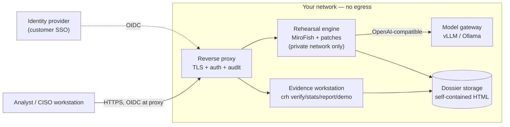

# Deployment guide

> Three supported shapes: an **offline evidence workstation** (zero dependencies, no network),
> a **private cloud** deployment (model gateway + simulation + workstation), and a fully
> **air-gapped** installation.
>
> Read the cost and sizing sections with their labels attached: the API cost and run time are
> **measured** and cited to the evidence pack; hardware and self-hosted-model figures are
> **planning estimates** with the assumptions written down, and we have not benchmarked a
> self-hosted model on the 30-event grid.

## 1. What you are actually deploying

There are two things, and they have different requirements:

| Layer | What it is | Requirements | Ships in this repo? |
|---|---|---|---|
| **A. Evidence workstation** | `crh verify`, `crh stats`, `crh report`, `crh demo`, `crh pack`, `crh site`: reproduce the published numbers and generate self-contained HTML dossiers from the shipped evidence pack | Python ≥ 3.9, standard library only, ~1 MB of files, no GPU, no network, no API key | **Yes** — `crisis_rehearsal/` + `pyproject.toml` |
| **B. Full rehearsal pipeline** | The actual simulation: knowledge graph → 7–12 persona agents → 2 rounds → ~8k-char report → judge | MiroFish (Node + Python backend), 5 patches, an LLM endpoint, ~10–60 GB disk | **No** — upstream MiroFish + patches; reproducible from `docs/patches.md` |

Most enterprise buyers should start with A on day one, verify the published numbers on their
own hardware, then decide about B. A is also the piece you can hand to an auditor, because it
is deterministic and hash-verified; B needs a model endpoint and produces a different report
on every run.

## 2. Shape A — offline evidence workstation

### Requirements

- Python 3.9–3.12 (CI matrix; 3.12 is what we test most). No third-party runtime packages.
- About **1 MB** of disk for the repository and evidence pack; the generated demo output is a
  few MB at most.
- No GPU, no inbound port, no outbound network for `verify / stats / report / demo`.

### Install

```bash
# recommended: isolated install from the repo
pipx install git+https://github.com/yepinggu66/crisis-rehearsal

# or from a clone, for development / pinning
git clone https://github.com/yepinggu66/crisis-rehearsal
cd crisis-rehearsal
python -m pip install -e .
```

Windows PowerShell is fine; set `$env:PYTHONIOENCODING = 'utf-8'` if your console mangles the
Chinese event names in the evidence pack.

### Verify and run (the first hour)

```bash
crh --version             # crh 0.3.0
crh verify                # every evidence file matches data/evidence.sha256, else exit 1
crh stats                 # 82.2%, 95% CI 78.5–85.9, STA 58 (below pass line 60)
crh demo --out demo       # verify + stats + 4 HTML dossiers + index, offline, no API key
```

`demo/` is a self-contained folder: open `demo/index.html` in a browser and you have the
tool's own evidence, not a marketing page. The four shipped reports are events **1, 6, 25 and
28** (`docs/reports/{1,28}.md`, `data/reports/{6,25}.md`); other events produce an
intelligence pack + real outcome + three-run scores, and the HTML says so instead of inventing
a report body.

Harden the host as you would any internal tool: unprivileged user, no listening socket, disk
encryption if the dossiers will hold client scenarios, and a read-only mount for `data/` if
you want the evidence pack to be physically immutable.

## 3. Shape B — private cloud (docker compose)

> The `docker-compose.yml` **shipped in this repo is the evidence workstation** (offline demo
> and `crh demo`), deliberately not the full MiroFish engine. The full-engine topology below is
> a **reference design**: you assemble the engine service from upstream MiroFish's own install
> instructions plus the five patches. We mark it as design so nobody mistakes the demo compose
> file for a production deployment.

Reference topology (everything inside your perimeter):



Design rules that matter more than the YAML:

1. **One egress policy.** Default-deny outbound. The engine talks only to the model gateway;
   the model gateway talks to nothing. If you use DeepSeek or another cloud API instead of a
   local model, that is a deliberate exception with a named subprocessors list — see
   `docs/enterprise/procurement.md` (DPA points) and `docs/enterprise/security.md`.
2. **Auth sits in front, not inside.** v0.3 has no built-in user system; put OIDC/SSO and
   per-user authorization at the reverse proxy now. Built-in RBAC is a **roadmap** item.
3. **Outputs are files.** Dossiers are single self-contained HTML files; archive them in the
   customer's document store with the evidence hash printed on the cover page. No database to
   patch, back up, or leave exposed.
4. **Pin the upstream commit.** MiroFish at `7657031ac01184afe2cb220f5ee3545573b5e843`, patches
   applied with `git apply --check` first (`docs/patches.md`). Upgrade = new pin, re-verify,
   re-score; never a floating `main`.

Practical service outline (adapt to your platform):

| Service | Image | Exposure | Notes |
|---|---|---|---|
| `workstation` | `python:3.12-slim` + this repo | internal only | `crh demo` smoke test on start; read-only `data/` |
| `engine` | upstream MiroFish backend | internal only | Needs 5 patches + `.env` with local graph + model endpoint |
| `model` | vLLM or Ollama | internal only | OpenAI-compatible API; no internet access |
| `proxy` | your standard ingress | HTTPS | OIDC auth, request audit, per-user routing |
| `storage` | object store / NFS | internal only | Dossiers + customer packs; encrypt at rest |

The shipped `docker-compose.yml` runs the evidence workstation only (read-only rootfs,
`no-new-privileges`, all capabilities dropped, one mounted output directory):

```bash
docker compose run --rm evidence-station verify
docker compose run --rm evidence-station stats
docker compose run --rm evidence-station demo --out /work/demo_out   # output lands in ./demo_out
docker compose up --build                                            # same demo on start
```

On a developer machine the same actions are `make verify`, `make stats`, `make demo`.

## 4. Shape C — air-gapped installation

Suitable for sensitive **non-classified** environments. It is **not** certified for classified
networks, and we do not claim it is — see `docs/government.md` for the classification rules and
the honest limits.

**Stage on a connected machine**

```bash
git clone https://github.com/yepinggu66/crisis-rehearsal
cd crisis-rehearsal
python -m pip download . -d wheelhouse          # if you install with pip (no runtime deps expected)
# or: pipx download / build a wheelhouse from the sdist
# model weights: fetch once and export to a file per your model gateway's tooling
```

Record a transfer manifest (sha256 of every artifact) on the staging side, transfer via the
approved media, and re-check the hashes on the isolated side before opening anything.

**Install on the isolated side**

```bash
python -m pip install --no-index --find-links wheelhouse crisis-rehearsal
# or: pipx install --pip-args="--no-index --find-links wheelhouse" <sdist-path>
export HF_HUB_OFFLINE=1 TRANSFORMERS_OFFLINE=1   # no model download attempts
crh verify && crh demo --out demo
```

Then run one rehearsal against a **past public event** with the local model, and compare its
dossier against the shipped one. If the local model is visibly weaker, that is expected — the
published grid used `deepseek-chat` and we have not benchmarked local models on it (see §5).

**Updates** are media-based: new repo tag → new manifest → transfer → `crh verify` → smoke
`crh demo` → re-run the acceptance checks in `docs/enterprise/procurement.md`. Keep the
previous tag and its dossier outputs until the new version passes.

## 5. Model backends

The judge and the simulator are the same model family in the published grid
(`deepseek-chat`; `data/repeat_v02/README.md` §Provenance). That is the number you are checking
against — changing the model means your results are your own baseline, not a reproduction.

| Backend | Where data goes | Cost / time evidence | Good for | Honest caveat |
|---|---|---|---|---|
| **DeepSeek API** (`https://api.deepseek.com`) | Prompts leave your network to DeepSeek | **Measured**: ~$0.03 and ~4 minutes per run (`data/repeat_v02/README.md`) | Reproducing the published grid; smallest hardware footprint | Cloud dependency; check DeepSeek's data terms and your own data-classification rules |
| **vLLM** (BAAI/Qwen/DeepSeek weights) | Stays in your network | Not measured by us; GPU sizing in §6 | High-throughput, OpenAI-compatible, private cloud | Model quality differs from `deepseek-chat`; re-score before quoting any rate |
| **Ollama** (7B–14B, quantized) | Stays on the host | Not measured by us | Workstation demo, air-gap POC | Weakest option; treat output as a rehearsal prompt, not a number |
| Any other OpenAI-compatible endpoint | Depends on the operator | — | Existing enterprise gateway | Same caveat: the 82.2% does not transfer automatically |

The v0.1/v0.2 scripts read `LLM_API_KEY`, `LLM_BASE_URL`, `LLM_MODEL_NAME` (environment wins,
`.env` at repo root is the fallback; the benchmark `.env` is in `docs/patches.md`). The v0.3
`crh` CLI needs no keys at all unless you are driving the upstream pipeline scripts.

## 6. Sizing and cost — with the labels on

### Measured (citable)

| Item | Value | Source |
|---|---|---|
| Cost per rehearsal run on DeepSeek API | **~$0.03** | `data/repeat_v02/README.md` §Provenance |
| Wall-clock per run | **~4 minutes** | same |
| Full published grid (90 runs) | **≈ $2.70** of API credit, **≈ 6 hours** on one machine | derived: 90 × $0.03, 90 × 4 min |
| Evidence workstation | ~1 MB repo, Python only, no GPU | measured in this repository |

### Planning estimates (not measured by us — verify with vendors)

| Deployment | vCPU / RAM | GPU / accelerator | Disk | Ballpark |
|---|---|---|---|---|
| Evidence workstation | 2 vCPU / 2–4 GB | none | < 1 GB | existing laptop or a small VM |
| Rehearsal worker + 7–14B model (4-bit) | 8 vCPU / 32 GB | ~12–24 GB VRAM class | 10–40 GB | single mid-range GPU server |
| Rehearsal worker + 32B 4-bit | 16 vCPU / 64 GB | ~24–48 GB VRAM | 40–80 GB | 1× or 2× data-center GPU |
| Rehearsal worker + 70B 4-bit | 32 vCPU / 128 GB | ~48–80 GB VRAM | 60–140 GB | multi-GPU node |
| Private cloud (all services) | 16–32 vCPU / 64–128 GB | as above | 100–500 GB incl. dossiers | internal VM pool |

Assumptions behind the estimates: 4-bit quantized weights, 2-round simulation, 7–12 agents,
one concurrent rehearsal, dossiers kept as single HTML files; model memory is the dominant
term and depends on the exact checkpoint. Cloud GPU list prices of roughly $0.5–$2 per GPU-hour
are 2026 list-price ballparks, **not quotes**; a 90-run local grid is therefore a
single-digit-hundreds-of-dollars exercise on rented GPUs, before engineering time. The API path
remains ~$3 for the same grid — that is the honest comparison.

## 7. Operations

- **Back up**: the evidence pack is in git (immutable, hashed); back up customer scenario
  packs, `demo/` and dossier outputs, and your `.env`/secret references. There is no database.
- **Upgrade**: check out the new tag → `crh verify` → `crh stats` and compare the four headline
  numbers → `crh demo` smoke test → keep the old tag until your acceptance suite passes.
- **Roll back**: `git checkout <previous tag>` and reinstall; evidence files are versioned, so
  a rollback cannot silently change a score.
- **Monitor**: the CLI prints what it reads (including the sha256 prefix of the scores file);
  there is no telemetry. Ship stdout/stderr to your log pipeline if you need an audit trail
  until the audit-log feature lands (roadmap).
- **Retention**: dossiers may contain your scenarios and simulated content. Define retention
  with the same rules as any internal memo; deletion is a file deletion, there is no hidden
  copy. See `docs/enterprise/security.md` §6.

## 8. Security baseline before go-live

- [ ] TLS + SSO at the reverse proxy; nobody reaches the engine directly.
- [ ] Default-deny egress; allowlist the model endpoint only.
- [ ] Local model, or a DPA/terms review for the cloud API (prompts leave the perimeter).
- [ ] `data/` read-only; `crh verify` scheduled daily or per release.
- [ ] Dossiers stored encrypted at rest; access via the document store's ACL.
- [ ] Secrets in a secret manager, never in a scenario pack or dossier.
- [ ] Incident path agreed: see `SECURITY.md` for disclosure; `docs/enterprise/security.md` §7
      for the STRIDE table and the open gaps.

*Design notes, not an assessment result. Full mapping and gaps:
[`docs/enterprise/compliance.md`](enterprise/compliance.md).*
