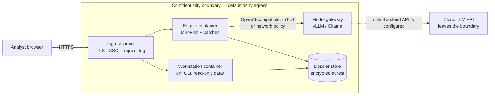

# Security design notes

> **设计说明，非测评结论 · This is a design description, not an assessment result.**
>
> No third-party security assessment, penetration test, code audit or certification has been
> performed on this project. No customer deployment is described here. Everything below is the
> intended design, the controls that are actually shipped today, and the gaps. Where a control
> depends on your deployment environment, it says so instead of taking credit for it.
>
> Scope: the open-source repository (`crisis_rehearsal/` CLI, `scripts/`, `data/`, generated
> HTML dossiers) and the reference deployment in [`deployment.md`](../deployment.md). Upstream
> MiroFish and OASIS are separate projects with their own security posture; they are used as
> documented dependencies, not audited by us.

## 1. Assets

| Asset | Why it matters | Where it lives |
|---|---|---|
| Public event corpus + seed packs | Integrity: a retro-edited seed would fake the backtest | `data/events.csv`, `data/seeds/`, hashed in `data/evidence.sha256` |
| Judge records | Integrity: the published numbers are computed from them | `data/repeat_v02/scores.jsonl`, hashed |
| Customer scenario packs | Confidentiality: may describe unannounced plans, incidents, people | Customer-controlled directory; JSON, schema-validated |
| Rehearsal dossiers | Confidentiality + integrity: may end up in a board pack | `demo/`, `output/`, customer storage |
| Model credentials / endpoint config | Confidentiality: a leaked key is spend and access | Environment variables or `.env` (v0.1/v0.2 scripts); secret manager recommended |
| Model weights (self-hosted) | Supply chain + licence terms of the chosen model | Customer model store |

## 2. Default data flow — what leaves your network

The honest answer has two halves:

1. **`crh verify / stats / report / demo / pack / site` run offline.** They read the repository
   and write files. There is no telemetry, no analytics, no auto-update, no crash reporting, no
   licence call-home. You can verify this by reading `crisis_rehearsal/` (standard library
   only) and by running `crh demo` with the network interface down.
2. **The full rehearsal needs a model endpoint.** If that endpoint is a cloud API (DeepSeek or
   any other OpenAI-compatible service), the seed pack, simulated posts, report excerpt and
   judge prompt are sent to it. That is an explicit configuration choice, not a hidden one —
   and the way to keep everything in-perimeter is Ollama/vLLM, as described in
   [`deployment.md`](../deployment.md) §5.

| Path | Data | Destination | Leaves the perimeter? |
|---|---|---|---|
| Evidence station | `data/` files, generated dossiers | local disk | **No** |
| Simulation, local model | Seed pack + simulated feed + report | vLLM/Ollama inside your network | **No** |
| Simulation, cloud model | Same | Provider API (e.g. `api.deepseek.com`) | **Yes — by your configuration** |
| Judge, local model | Event ground truth + 7k-char report excerpt | vLLM/Ollama inside your network | **No** |
| Judge, cloud model | Same | Provider API | **Yes — by your configuration** |
| Everything else | nothing | nothing | No |

"Default does not leave the domain" is therefore a property of the **evidence workstation and
the private-model deployment**. It is not a property of a cloud-model deployment, and no
document should claim otherwise.

## 3. Trust boundaries

Boundaries that need explicit controls: (a) analyst → ingress, (b) ingress → containers, (c)
engine → model endpoint, (d) operator → dossiers, (e) repository → upstream code/packages.

## 4. STRIDE threat model

| Threat | Affected component | Control today | Residual risk / owner |
|---|---|---|---|
| **Spoofing** — an unauthorised user drives a rehearsal or reads dossiers | CLI, dossier store | No auth in the open CLI by design; deploy behind SSO/OIDC ingress with per-user ACLs (`deployment.md` §3) | If you expose `crh` or a dossier directory on a shared host without access control, it is unprotected. Built-in RBAC is **roadmap** |
| **Spoofing** — a fake model endpoint receives prompts | Engine → model gateway | Pin `LLM_BASE_URL` to an internal DNS name; TLS; network policy; review `.env` | Customer responsibility; we do not pin certificates |
| **Tampering** — edit the evidence pack, then quote new numbers | `data/repeat_v02/`, seeds | `data/evidence.sha256` + `crh verify` exits 1 on mismatch; scores file sha256 prefix printed by `crh stats`; git history | A maintainer could regenerate the manifest in a fork — but then the diff and the hash change are visible. `crh verify` is the check to run yourself |
| **Tampering** — malicious scenario pack | `crh pack validate`, report generator | Schema validation; packs are text files a human reviews; generated HTML is static | HTML escaping of pack text must be verified on your build; do not open untrusted dossiers in a privileged browser session. Report-generator escaping is a test target (see `docs/cli.md`) |
| **Tampering** — modified upstream engine | MiroFish checkout | Pin commit `7657031`; patches reviewed; `git apply --check`; compare the five-file `git diff --stat` in `docs/patches.md` | You must actually run those checks; a floating branch defeats them |
| **Repudiation** — who ran which rehearsal with which pack | Operational trace | Evidence hashes + dossier timestamps + stdout; shell history if enabled | No tamper-evident operator audit log in the open CLI (**roadmap**, §6). Treat as an evidence gap for regulated use |
| **Information disclosure** — customer scenario content leaks | Packs, dossiers, model prompts | Classify packs before use; local model keeps prompts in-perimeter; encrypt dossiers at rest; restrict `demo/`/`output/` permissions | Cloud-model deployments disclose prompts to the provider. Dossier directory permissions are deployment responsibility |
| **Information disclosure** — credentials in files | `.env`, CI logs | `.env` is gitignored; examples use placeholders (`sk-...`); keys never belong in packs or dossiers | We cannot prevent a key pasted into a pack or a shell transcript; scan before sharing |
| **Denial of service** — oversized pack or report exhausts memory | CLI, engine | Local tool; schema validation; run as a resource-limited container | No hard limits/fuzzing published; avoid exposing the engine to untrusted users |
| **Elevation of privilege** — container escape / root | Deployment | Run containers as non-root, read-only root filesystem, drop capabilities, no host mounts except dossier volume | Deployment responsibility; no hardened image benchmarked by us |

**Threats we explicitly do not solve:** a compromised operator workstation, a malicious model
provider, prompt injection in source material, and exfiltration through a legitimate but
misused API key. Those are governance and monitoring problems, not something a rehearsal
engine can fix.

## 5. Credentials and model access

- The v0.1/v0.2 pipeline scripts read `LLM_API_KEY`, `LLM_BASE_URL`, `LLM_MODEL_NAME`;
  environment variables win, a repo-root `.env` is the fallback (`docs/patches.md` shows the
  benchmark `.env`). The v0.3 `crh` CLI does not need any key.
- Recommended: inject the key from your secret manager at process start; do not write it to a
  world-readable `.env` on a shared host; rotate on a schedule; scope a provider key to one
  project if the provider supports it.
- The key is consumed by the HTTP client only; the v0.3 CLI prints no environment variables.
  Dossiers are generated from event/pack content, not from environment state — but **review a
  dossier before sharing** if your pack text contains sensitive strings.
- Self-hosted model gateways should require authentication even on the internal network
  (vLLM `--api-key`, or an mTLS proxy), so a compromised container cannot use the GPU cluster.

## 6. Audit logging (design; roadmap for the CLI)

What a regulated buyer will ask for: *who ran which rehearsal, with which pack, against which
model, and what came out — tamper-evidently.*

**Shipped today:** deterministic command output (including the sha256 prefix of the scores file
read), the dossier's printed evidence hashes, file timestamps, and the git history of the
evidence pack. That is enough to prove **what evidence was used**, not **who used it**.

**Design for enterprise packaging (roadmap, not implemented in v0.3):**

| Field | Example |
|---|---|
| `ts` | RFC 3339 timestamp |
| `actor` | SSO subject from the ingress proxy |
| `command` | `crh report --event 6` / `rehearsal run --pack <sha256>` |
| `inputs` | pack sha256, event ids, model name + endpoint host |
| `outputs` | dossier sha256, output path |
| `result` | exit code, duration |
| `prev` | sha256 of the previous log line (hash chain) |

Storage: append-only JSONL in the customer's log pipeline; retention per the customer's
records policy. Until it ships, route container stdout/stderr to your SIEM and treat it as a
best-effort trace — don't represent it as a compliance-grade audit trail.

## 7. Multi-tenancy and RBAC (design)

The open-source CLI is **single-operator and file-based**. It is not safe to expose as a
shared network service, and it has no notion of users.

| Role (design) | Can do | Maps to today |
|---|---|---|
| Viewer | read dossiers, run `crh verify` | read-only filesystem ACL |
| Operator | run rehearsals, write outputs | write ACL on `output/` |
| Reviewer | sign off a pack, mark a dossier final | file-based review record |
| Auditor | read audit log + evidence hashes, no write | SIEM access |
| Admin | manage packs, model config, retention | deployment/IAM admin |

Today the practical pattern is: one directory per tenant/engagement, OS-level permissions, one
SSO account per operator at the ingress. A productised RBAC layer is **roadmap**
(`ROADMAP.md`), and we will not pretend otherwise in a procurement answer.

## 8. Retention and destruction

| Data | Default retention | How to delete |
|---|---|---|
| Public evidence pack | Lifetime of the repository (it is the evidence) | Do not delete — it is the citation base |
| Customer scenario packs | Customer decision | delete the pack file + its backups; schema validation leaves no copies |
| Dossiers (`demo/`, `output/`) | Customer decision | delete files; no database, no index, no hidden copy |
| Model prompts | Cloud provider's retention per its terms; local model — logs depend on gateway | choose a provider with the retention terms you need, or use a local model; clear gateway logs |
| Shell history / CI logs | Operator's defaults | scrub per your policy; keys should never appear there |

Deletion is file deletion plus backup rotation — there is no server-side store to submit a
deletion request to, and no telemetry copy. Verify with a filesystem search before signing a
destruction certificate.

## 9. Supply chain

- **Runtime:** v0.3 CLI is standard-library only; there is no third-party runtime package to
  compromise for `verify/stats/report/demo`. The optional `[llm]` extra pulls `httpx` only for
  the pipeline scripts.
- **Upstream engine:** MiroFish is pinned to a commit and patched mechanically (five files,
  reviewed; `docs/patches.md`). Treat it as third-party code: review the patches, run
  `git apply --check`, compare the diff stat. OASIS is Apache-2.0 and installed by upstream's
  setup.
- **Model weights:** provenance and licence are the customer's choice. Verify checksums; a
  model pulled from an unofficial mirror is a supply-chain risk.
- **CI:** GitHub Actions builds and tests the package; no secrets are exposed to workflows that
  run on pull requests from forks.

## 10. What this document does not claim

No penetration test, no source-code audit, no fuzzing campaign, no ISO 27001 certification, no
SOC 2 report, no 等保测评 result, no government security assessment, no "security by design"
award. If a document in this repository ever suggests otherwise, it is a bug — please open an
issue.

Report a vulnerability through [`SECURITY.md`](../../SECURITY.md), not a public issue.

## Related documents

- [Compliance mapping and gaps](compliance.md) — how these controls map to 等保 / ISO / SOC 2, and what is missing.
- [Procurement pack](procurement.md) — DPA points, acceptance criteria, SLA template.
- [Deployment guide](../deployment.md) — the reference topologies and go-live checklist.
- [Architecture](../architecture.md) — trust boundaries in the pipeline.
- [Enterprise overview](overview.md) — what a buyer is actually buying.
